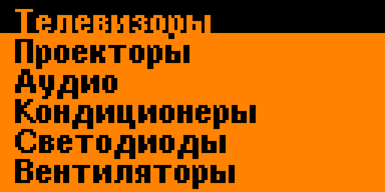
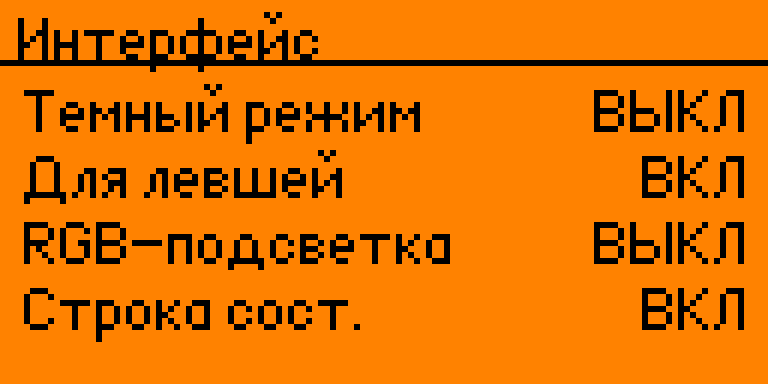
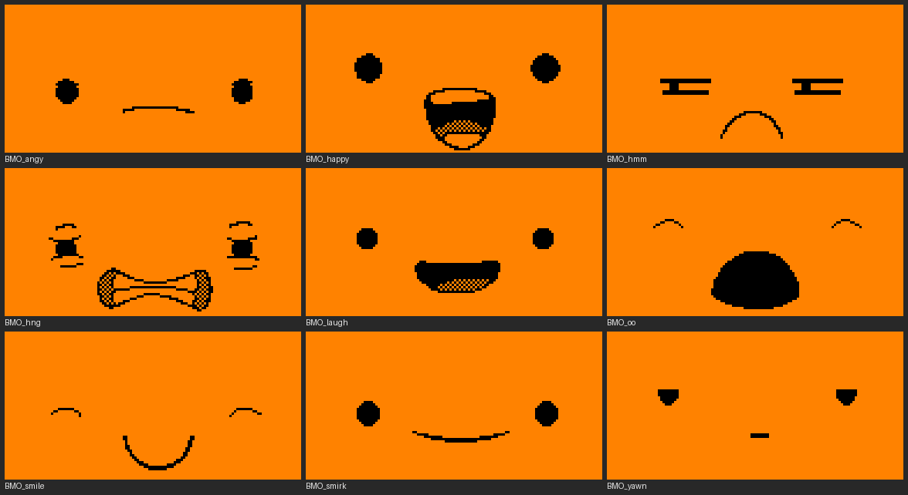
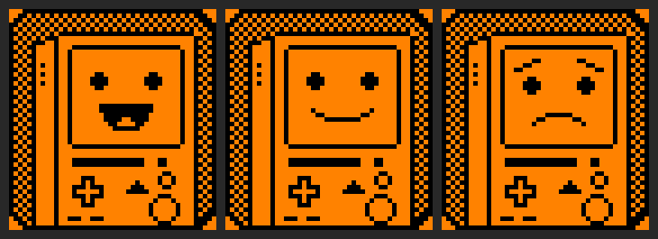

# flipper-momentum-ru — русская прошивка Flipper Zero (Momentum)

Полный русский перевод интерфейса прошивки **Momentum** (`mntm-012`) для Flipper Zero:
меню, настройки, встроенные приложения (NFC, ИК, Sub-GHz, RFID, iButton, BadUSB и др.)
и 243 приложения из набора. Плюс кириллические шрифты, починка вывода длинного текста
и небольшая доработка (перенос фишки «сохранить найденный сигнал» из Unleashed).

> English: a full Russian (Cyrillic) UI translation of the Momentum `mntm-012` Flipper Zero
> firmware — ready-to-flash build in **Releases**, plus the scripts to reproduce it on your own.

На момент публикации рабочего русского перевода Flipper в открытом доступе не нашлось,
так что это, похоже, первый.

### Как это выглядит

Главное меню и настройки — настоящими шрифтами прошивки, в цветах экрана Flipper:

 

---

## Два способа

### 1. Готовая прошивка (просто прошить)

В разделе **[Releases](../../releases)** лежит собранный пакет `flipper-z-f7-update-*.tgz`.

- **Через qFlipper:** `File → Install from file` → выбрать `.tgz`.
- **Вручную:** распаковать папку пакета в `SD/update/` на карте Flipper и на приборе
  запустить `update.fuf` (или `update install ...` в консоли).

Темы, настройки и приложения на карте сохраняются. Откат на обычный Momentum — тем же способом
его официальным пакетом.

> Прошивка заморожена на версии `mntm-012`. Чтобы обновить Momentum, не теряя русский,
> прошивку надо пересобрать русификатором (способ 2) на новой версии.

### 2. Русификатор (собрать самому / под новую версию Momentum)

Папка **`rusifikator/`** — скрипты, которые накладывают перевод на чистые исходники Momentum
и дают воспроизводимую сборку. Нужны Python 3 с `pillow` и `heatshrink2`, и среда сборки Flipper
(`fbt` ставит её сам).

```bash
# 1. клонировать Momentum нужной версии рядом со скриптами, в папку momentum-firmware
git clone --branch mntm-012 --recurse-submodules \
    https://github.com/Next-Flip/Momentum-Firmware.git momentum-firmware

# 2. наложить перевод (откатывает исходники в чистое состояние и накладывает заново)
cd rusifikator
python apply_ru.py ../momentum-firmware

# 3. собрать и прошить штатным fbt
cd ../momentum-firmware
./fbt COMPACT=1 DEBUG=0 updater_package
./fbt flash_usb_full      # или прошить собранный пакет вручную
```

Что делает русификатор: кириллические шрифты в `lib/u8g2`, правки вывода текста под UTF-8
(`patch_gui.py`), перевод надписей по словарю (`ru_dict.py`) и строк приложений
(`ext_tr/`, `ext2_tr/`), русские названия в меню. Правки кода бьют в точные места и при
несовпадении **останавливают сборку с ошибкой** (не собирают криво) — значит, под новую
версию Momentum их, возможно, придётся поправить.

Доработка «сохранить найденный сигнал» в ИК-универсале — отдельным патчем
`patches/ir-save-signal.patch` (накладывается на исходники Momentum: `git am` или `git apply`).

---

## Тема BMO (бонус)

`bmo-theme/` — **авторская тема**: мордочки BMO (Бимо) из «Время приключений», нарисованные
с нуля специально для этого проекта (не взяты из других наборов). 9 анимаций главного
экрана, движения сверены с мультфильмом, монохром 128×64.



Портреты для паспорта (доволен / обычный / расстроен):



- `bmo-theme/BMO_Faces/` — готовый набор. Скопировать в `SD/asset_packs/` на карте,
  затем на приборе: Настройки Momentum → Интерфейс → Графика → Тема → BMO_Faces.
- `bmo-theme/source/` — исходные картинки и скрипты-генераторы (можно переделать под себя).

---

## Что переведено

- **По-русски:** главное меню, настройки, встроенные приложения (NFC, ИК, Sub-GHz, RFID,
  iButton, BadUSB, GPIO, U2F и др.), окна/кнопки, и 243 приложения набора — названия, меню,
  значения настроек, экраны сведений.
- **Осталось английским:** игры (намеренно), технические обозначения (UID, NFC, MHz…),
  и 13 приложений, которые рисуют текст своими шрифтами без кириллицы.

---

## Лицензия и благодарности

- Прошивка Flipper под **GPL-3.0**, этот проект — производная, тоже под GPL-3.0 (см. `LICENSE`).
- Основано на [Momentum Firmware](https://github.com/Next-Flip/Momentum-Firmware),
  которая основана на [официальной прошивке Flipper](https://github.com/flipperdevices/flipperzero-firmware).
- Фишка «сохранить сигнал» перенесена из [Unleashed Firmware](https://github.com/DarkFlippers/unleashed-firmware).
- Кириллический шрифт — из [u8g2](https://github.com/olikraus/u8g2) (BSD-2-Clause).
- BMO — персонаж «Adventure Time» (Cartoon Network); тема сделана фанатом, некоммерчески.

Прошивки-форки — на свой риск. Соблюдайте местные законы по радиочастотам.
